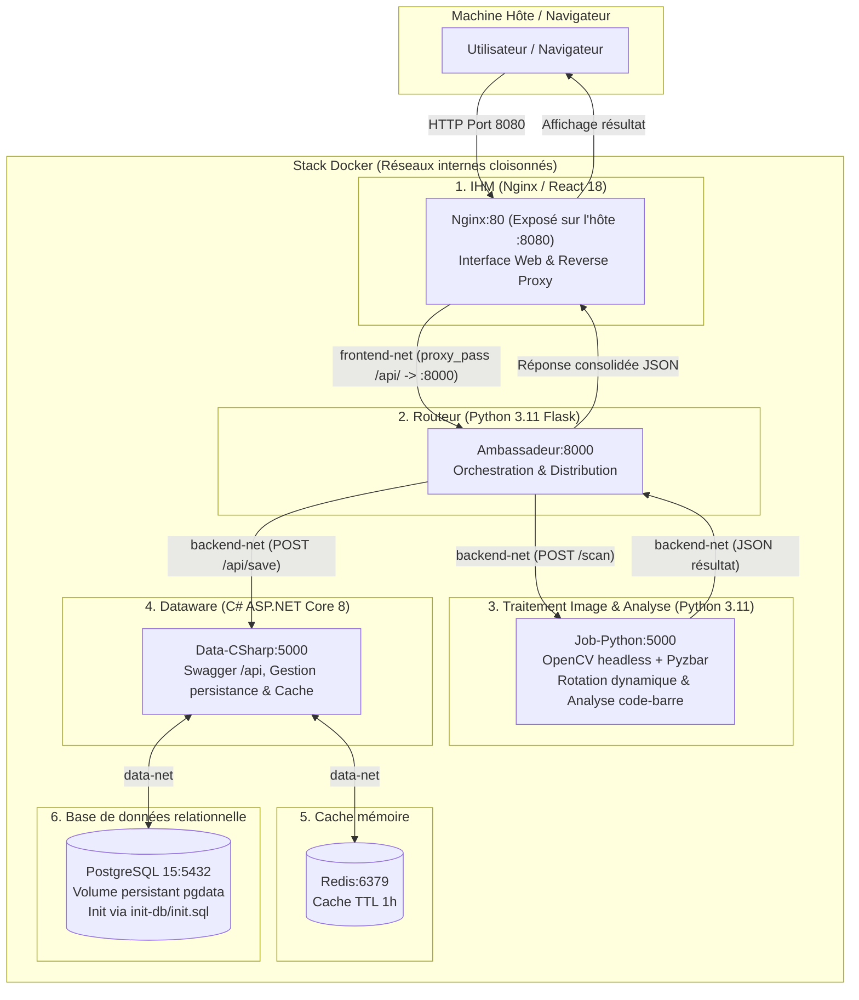

# Projet_QRcode

Application conteneurisée basée sur une architecture micro-services en pipeline, permettant la détection robuste, l'analyse approfondie et la persistance de **QR codes** et **codes-barres** à partir d'un flux vidéo ou d'images fixes (même inclinées).

---

## Architecture du Projet

Le système est entièrement encapsulé dans une stack Docker orchestrée par `docker-compose`. La stack respecte une politique stricte d'isolation réseau : **seul le port 8080 est exposé sur la machine hôte**, servant de point d'entrée unique via l'IHM.



---

## Sécurité et Isolation Réseau (Multi-vnet)

L'infrastructure Docker implémente une isolation stricte par segmentation réseau (aucun réseau bridge par défaut partagé) :

* **`frontend-net`** : connecte exclusivement l'**IHM** et l'**Ambassadeur**.
* **`backend-net`** : connecte l'**Ambassadeur**, le **Job Python** et le service **DATA C#**.
* **`data-net`** : connecte uniquement le service **DATA C#**, **Redis** et **PostgreSQL**.

> **Principe de moindre privilège :** L'IHM, l'Ambassadeur et le Job Python sont physiquement isolés de la base de données PostgreSQL et du cache Redis. Seul le service C# dispose d'une interface réseau vers la couche de données.

### Gestion des identifiants et des secrets
* **Utilisateur non-root dédié :** Le service C# se connecte à PostgreSQL avec un utilisateur applicatif aux droits restreints (`data_user`), créé automatiquement au démarrage via le script [`init-db/init.sql`](init-db/init.sql). Le superutilisateur PostgreSQL (`postgres`) n'est jamais utilisé par l'application.
* **Variables d'environnement :** Aucun mot de passe n'est codé en dur. Les identifiants et URLs de services sont externalisés dans un fichier `.env` (non commité), dont le modèle est documenté dans [`.env.example`](.env.example).

---

## Détail des Micro-services et Composants

| Service | Technologie | Rôle & Responsabilité | Port interne | Port hôte |
| :--- | :--- | :--- | :--- | :--- |
| **IHM** | Nginx Alpine, React 18, CSS moderne | Interface utilisateur (webcam en temps réel ou upload d'image) et reverse proxy vers l'Ambassadeur. | 80 | **8080** |
| **Ambassadeur** | Python 3.11, Flask, Requests | Routeur / Orchestrateur interne. Reçoit le scan de l'IHM, interroge le Job d'analyse, puis achemine les résultats au Dataware C#. | 8000 | *Aucun* |
| **Job Python** | Python 3.11, OpenCV headless, Pyzbar | Traitement d'image : prétraitement (niveaux de gris, contraste), rotation dynamique multi-angles (0° à 180°), décodage et analyse approfondie des codes-barres. | 5000 | *Aucun* |
| **DATA C#** | C# .NET 8 (ASP.NET Core Minimal API) | Datawarehouse d'accès aux données avec documentation Swagger. Gère les opérations de lecture/écriture avec stratégie de cache-aside. | 5000 | *Aucun* |
| **Redis** | Redis 7 Alpine | Cache en mémoire pour accélérer les requêtes fréquentes et réduire la charge SQL. | 6379 | *Aucun* |
| **PostgreSQL** | PostgreSQL 15 Alpine | Stockage relationnel persistant des codes scannés, du compteur d'occurrences et de l'horodatage. | 5432 | *Aucun* |

---

## Fonctionnalités Clés

1. **Point d'entrée unique sécurisé (Port 8080) :**
   Tous les services internes (Python, C#, Redis, PostgreSQL) sont isolés sur les réseaux Docker privés. Seule l'IHM Nginx est accessible depuis l'extérieur, redirigeant les requêtes `/api/*` vers l'Ambassadeur.
2. **Lecture multi-angles par rotation dynamique :**
   Les codes-barres physiques photographiés ou scannés de travers sont souvent indétectables pour les bibliothèques standards. Le **Job Python** teste automatiquement des rotations de l'image de 0° à 180° par pas de 15°, garantissant la lecture quel que soit l'angle d'inclinaison.
3. **Analyse Python approfondie des codes-barres :**
   * **EAN-13** : Validation de la clé de contrôle (algorithme modulo 10) et détection du pays d'origine via le préfixe GS1 (ex. 300-379 : France, 400-440 : Allemagne, etc.).
   * **Code 39 / Code 128** : Validation du format alphanumérique et identification du type d'usage (inventaire industriel, logistique).
4. **Persistance et mise en cache à double niveau :**
   * Chaque scan incrémente le compteur `scan_count` dans **PostgreSQL** et met à jour la date `last_scan`.
   * Le résultat est automatiquement mis en cache dans **Redis** avec une durée de vie (TTL) d'une heure.
   * Les requêtes de consultation (`GET /api/scan/{valeur}`) interrogent d'abord Redis et ne sollicitent PostgreSQL qu'en cas de cache-miss.
5. **Documentation interactive Swagger (OpenAPI) :**
   L'API du service C# intègre la spécification OpenAPI via Swashbuckle, accessible sur l'URL interne `/swagger`.

---

## Arborescence du Projet

```text
Projet_QRcode/
├── ambassadeur/
│   ├── .dockerignore          # Exclusion des caches Python et fichiers .env
│   ├── Dockerfile             # Image Python slim pour le routeur
│   ├── main.py                # Pipeline d'orchestration Flask
│   └── requirements.txt       # Flask, requests
├── data-csharp/
│   ├── .dockerignore          # Exclusion des dossiers bin/ et obj/
│   ├── Dockerfile             # Multi-stage build .NET 8 SDK -> ASP.NET Runtime
│   ├── DataService.csproj     # Dépendances Npgsql, Redis et Swashbuckle (Swagger)
│   └── Program.cs             # Minimal API C#, mapping PostgreSQL/Redis et Swagger
├── data-csharp.Tests/
│   ├── data-csharp.Tests.csproj # Projet de tests unitaires xUnit .NET 8
│   └── ScanModelTests.cs      # Tests de validation modèles et clés de cache
├── ihm/
│   ├── Dockerfile             # Image Nginx Alpine
│   ├── index.html             # Application React 18 (Modes Caméra et Image)
│   ├── nginx.conf             # Configuration proxy_pass et fichiers statiques
│   └── style.css              # Feuille de style responsive
├── init-db/
│   └── init.sql               # Initialisation utilisateur dédié data_user et table scans
├── job-python/
│   ├── .dockerignore          # Exclusion des caches Python et fichiers .env
│   ├── Dockerfile             # Python slim allégé (libzbar0, libglib2.0-0, sans libgl1)
│   ├── main.py                # Décodage OpenCV/Pyzbar et analyse code-barre
│   └── requirements.txt       # Flask, pyzbar, opencv-python-headless, numpy
├── picture/                   # Images d'exemples et de tests
│   ├── code-barre_PC-UPJV_67430(1).jpg
│   └── code-barre_PC-UPJV_67430(2).jpg
├── tests/                     # Suite de tests unitaires Python (unittest)
│   ├── __init__.py
│   ├── test_ambassadeur.py    # Mocks HTTP et routage de l'Ambassadeur
│   └── test_job_python.py     # Tests rotation OpenCV et analyse EAN-13/Code39
├── .env.example               # Modèle des variables d'environnement
├── docker-compose.yml         # Orchestration complète de la stack (multi-réseaux)
├── Projet_QRcode.sln          # Solution Visual Studio regroupant DataService et Tests
├── README.md                  # Documentation complète du projet
├── run_tests.ps1              # Script PowerShell d'exécution unifiée des tests
└── run_tests.sh               # Script Bash d'exécution unifiée des tests
```

---

## Tests Unitaires Automatisés (Jalon J7)

Le projet intègre une suite complète de **18 tests unitaires** couvrant l'ensemble des micro-services applicatifs :
* **11 tests Python** : validation de la matrice de rotation OpenCV, algorithme de checksum EAN-13, détection GS1, validation Code39/Code128, rejets des requêtes invalides et mocks de routage de l'Ambassadeur.
* **7 tests C#** : intégrité des modèles `ScanRequest`, conservation des valeurs et cohérence de génération des clés Redis.

### Lancement centralisé des tests

Les tests s'exécutent en une seule commande via les scripts situés à la racine du projet :

#### Sous Windows (PowerShell) :
```powershell
powershell -ExecutionPolicy Bypass -File .\run_tests.ps1
```
*(ou simplement `.\run_tests.ps1` si votre politique d'exécution locale autorise les scripts).*

#### Sous Linux / macOS / Git Bash :
```bash
./run_tests.sh
```

---

## Installation et Lancement

### Prérequis
* [Docker Desktop](https://www.docker.com/products/docker-desktop/) installé et démarré.
* [Git](https://git-scm.com/) pour cloner le projet.

### 1. Configuration de l'environnement
Copiez le fichier d'exemple pour initialiser vos variables locales (déjà pré-configurées pour un démarrage immédiat) :

```bash
cp .env.example .env
```

### 2. Démarrage de la stack
À la racine du projet, lancez la construction et le démarrage de l'ensemble des conteneurs :

```bash
docker-compose up --build -d
```
*(ou `docker compose up --build -d` selon votre version de Docker)*

### 3. Vérification de l'état des conteneurs
Assurez-vous que tous les services sont actifs et sains (`healthy`) :

```bash
docker-compose ps
```

---

## Utilisation & Tests Applicatifs

Une fois la stack démarrée, ouvrez votre navigateur web à l'adresse :
👉 **[http://localhost:8080](http://localhost:8080)**

Deux modes d'utilisation sont proposés :
* **Mode Caméra :** Active votre webcam pour analyser le flux vidéo en continu toutes les 1,5 secondes *(nécessite localhost pour l'accès caméra sans HTTPS)*.
* **Mode Image :** Permet de téléverser une image fixe (JPG, PNG, WEBP). Vous pouvez tester immédiatement avec les images fournies dans le dossier `picture/` (ex. `code-barre_PC-UPJV_67430(1).jpg` qui est décodé grâce à une rotation dynamique à 30°).

---

## Endpoints de l'API

Tous les appels transitent par le port **8080** via le reverse proxy Nginx :

| Méthode | Route | Description |
| :--- | :--- | :--- |
| `POST` | `/api/scan` | Envoie un fichier image (`multipart/form-data`) pour analyse par le pipeline complet. |
| `GET` | `/api/scan/{valeur}` | Interroge l'historique et le nombre de scans d'un code (interroge Redis d'abord, puis PostgreSQL). |

---

## Commandes Utiles de Maintenance

* **Afficher les logs en temps réel d'un service précis :**
  ```bash
  docker-compose logs -f ambassadeur
  docker-compose logs -f job-python
  docker-compose logs -f data-csharp
  ```

* **Arrêter la stack sans perdre les données de la base :**
  ```bash
  docker-compose down
  ```

* **Arrêter la stack et réinitialiser complètement la base de données (suppression du volume) :**
  ```bash
  docker-compose down -v
  ```

* **Accéder au terminal interactif de la base PostgreSQL :**
  ```bash
  docker-compose exec psql psql -U postgres -d ma_base_de_donnees
  ```
